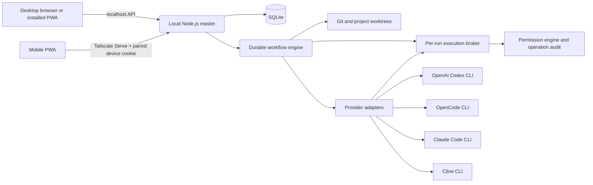

# Architecture

## System boundary

The server is authoritative for run state. UI reloads query persisted state; stage output and event history are recorded as execution proceeds. The browser never receives provider credentials.

## Implementation choices

- React, TypeScript, Vite, and a service-worker-backed PWA provide one UI surface for desktop and mobile browsers.
- A Node.js/Fastify service performs local filesystem and process operations. It is a better fit than browser code for provider CLIs, repository discovery, and child-process cancellation.
- SQLite stores projects, workflow definitions, workflow snapshots, runs, stages, usage, approvals, and interventions. Migrations are versioned.
- Providers are adapters with explicit capability flags. Missing model/usage/allowance support is represented as unavailable rather than inferred. Codex, Claude Code, and OpenCode disable their native project-action tools and expose only Turing's broker; Cline uses its approval IPC boundary.
- `child_process.spawn` uses argument arrays with shell expansion disabled for AI CLIs. File reads/writes/deletes and project package scripts pass through a per-run token-protected broker. Operations are checked against project scope, secret rules, and the selected Turing permission mode, then recorded in SQLite.
- First-class Git workflow operations are handled by the master against the isolated run worktree. Checkpoints, commits, pushes, merges, and restores have a separate durable operation ledger; merge and restore approvals include the operation context, and force-push is not available.
- The API binds to loopback only. When reached through Tailscale Serve, it requires the Serve user identity and a desktop-approved, expiring device cookie. Pairing administration stays on the desktop. The PWA stores per-device master profiles and switches by navigating to the selected master's own origin; cookies and API requests remain origin-scoped, and there is no cross-machine proxy or failover.

## Run lifecycle

`QUEUED → PREPARING → RUNNING ↔ WAITING_FOR_APPROVAL | WAITING_FOR_USER → COMPLETED | FAILED | CANCELLED`

Each stage has an independent state and an event trail. Workflow JSON is copied into the run at creation so later edits cannot rewrite history. Every loop and parallel group has a configured limit.

## Desktop and PWA boundary

The PWA is a client of the selected desktop master. It may cache the shell and display the last loaded state, but it must not claim that a launch, approval, or intervention succeeded without a server response. The local master owns run state and provider lifetimes independently of React. Remote use is available through Tailscale Serve with desktop-approved pairing; the master still refuses direct network binding. Machine profiles contain only connection/display metadata and direct the browser to one origin at a time. Native push is not complete.
