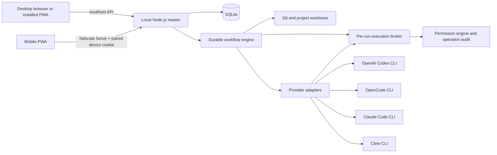

# Architecture

## System boundary

The server is authoritative for run state. UI reloads query persisted state; stage output and event history are recorded as execution proceeds. The browser never receives provider credentials.

## Implementation choices

- React, TypeScript, Vite, and a service-worker-backed PWA provide one UI surface for desktop and mobile browsers.
- A Node.js/Fastify service performs local filesystem and process operations. It is a better fit than browser code for provider CLIs, repository discovery, and child-process cancellation.
- SQLite stores projects, workflow definitions and defaults, reusable connection-profile metadata, model presets, workflow/run snapshots, catalog metadata, stages, usage, approvals, and interventions. Migrations are versioned. Provider credentials remain in provider CLIs or separately supported desktop credential storage; profile records hold references and display metadata only.
- Providers are adapters with explicit capability flags. Missing model/usage/allowance support is represented as unavailable rather than inferred. Codex, Claude Code, and OpenCode disable their native project-action tools and expose only Turing's broker; Cline uses its approval IPC boundary.
- `child_process.spawn` uses argument arrays with shell expansion disabled for AI CLIs. File reads/writes/deletes and project package scripts pass through a per-run token-protected broker. Operations are checked against project scope, secret rules, and the selected Turing permission mode, then recorded in SQLite.
- First-class Git workflow operations are handled by the master against the isolated run worktree. Checkpoints, commits, pushes, merges, and restores have a separate durable operation ledger; merge and restore approvals include the operation context, and force-push is not available.
- The API binds to loopback only. When reached through Tailscale Serve, it requires the Serve user identity and a desktop-approved, expiring device cookie. Pairing administration stays on the desktop. The PWA stores per-device master profiles and switches by navigating to the selected master's own origin; cookies and API requests remain origin-scoped, and there is no cross-machine proxy or failover.

## Provider configuration and context

An AI stage keeps execution backend, connection profile, provider/billing lane, exact model ID, native variant or reasoning settings, and catalog snapshot separate. Workflow defaults inherit into stage-kind defaults and then individual nodes. Profiles select a connection and billing lane without storing credentials. Presets contain model configuration only. Run Preview resolves the final configuration and groups stages by billing lane.

The deterministic workflow engine remains authoritative, including when the optional AI Orchestrator stage is used. Subscription Only and Lock Providers are enabled by default. Provider-side billing remains outside Turing's control where the provider does not expose a supported status mechanism; for OpenCode Go, the UI explicitly reports that account-side PAYG fallback cannot be verified.

Before model execution, the engine prepares bounded context and structured handoff artifacts. Each AI stage has its own strategy, file/token/size limits, inclusion rules, and over-limit behavior. The execution broker applies the same context constraints to later tool reads and outputs. Preview token counts are estimates, not provider-reported exact input usage. See [Phase 3.6 configuration](phase3.6-provider-model-context.md) for defaults and precedence.

## Run lifecycle

`QUEUED → PREPARING → RUNNING ↔ WAITING_FOR_APPROVAL | WAITING_FOR_USER → COMPLETED | FAILED | CANCELLED`

Each stage has an independent state and an event trail. Workflow JSON is copied into the run at creation so later edits cannot rewrite history. Every loop and parallel group has a configured limit.

## Desktop and PWA boundary

The PWA is a client of the selected desktop master. It may cache the shell and display the last loaded state, but it must not claim that a launch, approval, or intervention succeeded without a server response. The local master owns run state and provider lifetimes independently of React. Remote use is available through Tailscale Serve with desktop-approved pairing; the master still refuses direct network binding. Machine profiles contain only connection/display metadata and direct the browser to one origin at a time. Closed-client Web Push is available when the operator configures VAPID and a browser subscription; browser vendor push relays provide delivery, so physical delivery still needs platform acceptance.
